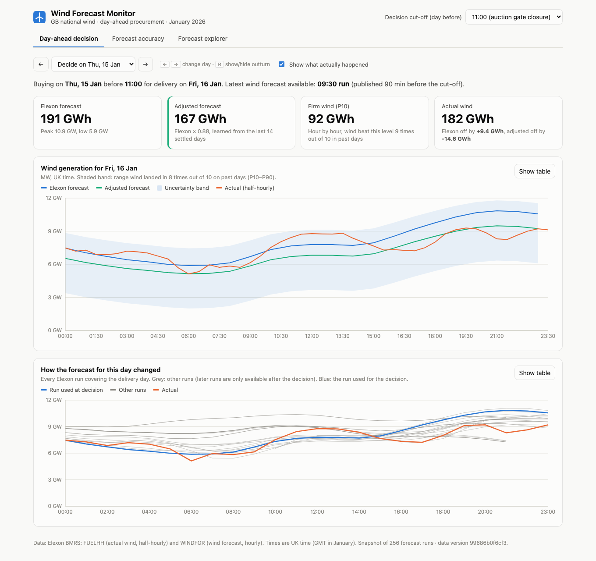

# Wind Forecast Monitor

A web app for a GB energy supplier's day-ahead trading desk. It shows **which wind forecast was available
when each January 2026 purchase decision had to be made**, and **how accurate those forecasts were**,
so the desk can size how much extra power to buy with the error in mind.

**Live app:** https://q7m4x9kp.vercel.app · **Video walkthrough:** _VIDEO_URL_



## Start the app

### With Docker (recommended)

```bash
docker compose up --build
# open http://localhost:8080
```

Two containers: `backend` (FastAPI on port 8000, internal only, with a health check) and `frontend`
(nginx serving the React build on port 8080 and forwarding `/api/*` to the backend).

### Without Docker

```bash
# backend (Python 3.12+)
cd backend
python -m venv .venv && source .venv/bin/activate
pip install -r requirements-dev.txt
uvicorn app.main:app --reload --port 8000      # OpenAPI docs at http://localhost:8000/docs

# frontend (Node 22+), in a second terminal
cd frontend
npm install
npm run dev                                    # http://localhost:5173 (proxies /api to :8000)
```

### Tests and checks

```bash
cd backend  && pytest --cov=app && ruff check . && ruff format --check .
cd frontend && npm test && npm run lint && npm run build
pre-commit install          # optional: run linters on every commit
```

GitHub Actions runs all of this on every push, plus an API-contract check and a Docker Compose smoke
test (see [CI](#engineering-practices)).

### Refresh the data

The app ships with a snapshot of the Elexon data (`backend/data/*.csv.gz`, ~100 KB). To rebuild it from
the live API (no key needed; takes about 3 s):

```bash
cd backend && python -m scripts.fetch_data
```

## What the app does

| Page | Question it answers |
|---|---|
| **Day-ahead decision** | "It's 11:00 on D-1. What did the latest forecast say for tomorrow, how much wind can I count on, and (looking back) what actually happened?" Step through days with ←/→ and press R to hide or show the outturn. See how every forecast run for the day evolved. |
| **Forecast accuracy** | "How wrong is the forecast, in which direction, and when?" Plain-English findings; a day × hour error heatmap (click a cell to open that day); error vs forecast horizon, by hour, by forecast size; daily energy error; distribution; raw vs adjusted comparison with a confidence interval; CSV export. |
| **Forecast explorer** | "How good is a forecast made *h* hours ahead?" Any date range plus a horizon slider: for each hour, the latest forecast published at least *h* hours before it. |

The **decision cut-off** (default 11:00, GB day-ahead auction gate closure) drives the whole app. All
view state lives in the URL, so any screen can be shared as a link, e.g.
`/?tab=decision&day=2026-01-27&cutoff=09:00`.

### Key findings for January 2026

* The forecast available at 11:00 on D-1 was **too high in 84% of hours, by 1.7 GW on average**
  (MAE 2.0 GW, about 18% of mean wind output). Taken as is, it would have left the desk short.
* The gap grows with the size of the forecast (about 6% at low wind, about 15% above 15 GW), and misses
  come in multi-day runs (e.g. 11–12 and 28 Jan). Both are easy to see in the heatmap.
* A simple **adjusted forecast** (Elexon forecast × the actual/forecast ratio of the last 14 fully
  settled days) cut MAE by **34% (95% CI 21–45%, day-block bootstrap)**. It was better on 22 of 29
  days, and bias fell from 1.67 GW to 0.09 GW. It uses only data available at decision time.
* The **P10–P90 band** held 78% of actual hours against an 80% target. Actual wind fell below P10 in 17%
  of hours (target 10%), so the floor is a little optimistic; this is reported in the app.

## Data and assumptions

* **Sources:** Elexon BMRS, national level only.
  * Actuals: `FUELHH` stream, `fuelType = WIND`, half-hourly `startTime` and `generation` (MW).
  * Forecasts: `WINDFOR` stream: hourly `startTime`, `publishTime`, `generation` (MW). About 8 runs a day,
    each looking up to about 66 h ahead.
* **Scope:** decisions made on 1–31 Jan 2026, i.e. delivery days 2 Jan – 1 Feb. The snapshot holds
  forecasts published 31 Dec – 31 Jan (256 runs) and actuals for 1 Jan – 1 Feb (1,536 half-hours,
  none missing).
* **Decision time:** delivery day D is bought on D-1 at the cut-off (11:00 UK by default; GMT = UTC in
  January). The forecast used is the latest run with `publishTime <= cut-off`. In practice that is the
  09:30 run, covering D at 14.5–37.5 h ahead. If that run lacked an hour, the hour falls back to the
  latest earlier run that covers it.
* **Delivery day** = 00:00–24:00 UK time on D (settlement periods 1–48).
* **Matching:** forecasts are hourly and actuals half-hourly, so each hourly forecast is compared with
  the actual for the same `startTime`. Daily energy = sum of the 24 hourly values × 1 h. Totals were
  cross-checked by hand against the raw API (a test pins them).
* **Cleaning:** forecast rows whose `startTime` is before their `publishTime` are dropped. Duplicates
  keep the latest publication.
* **Sign convention:** `error = forecast − actual`. Positive means less wind than forecast, which is a
  shortfall the desk must cover.

### Adjusted forecast and uncertainty band (walk-forward, no look-ahead)

For delivery day D, decided on D-1:

1. Use delivery days ≤ D-2 (fully settled before the decision) within the last 14 days.
2. `scale = Σ actual / Σ forecast` over those hours; `adjusted = forecast × scale`. A ratio fits because
   the error grows with forecast size.
3. Band: P10 = adjusted − 90th percentile of past adjusted errors; P90 = adjusted − 10th percentile.
4. Days with less than 24 h of usable history (2 and 3 Jan) keep the raw forecast and get no band.
5. Significance: paired bootstrap that resamples **whole days**, because hourly errors within a day are
   strongly correlated (resampling hours would overstate confidence).

## Architecture

```
React 19 + TypeScript (Vite, TanStack Query, Recharts, D3 scales)
   │  typed client generated from OpenAPI · GET /api/v1/* (same origin)
   ▼
FastAPI ─ app/main.py           HTTP: validation, error shape, ETag caching, routes (/api/v1)
        ─ app/observability.py  request id, JSON access logs, Server-Timing
        ─ app/schemas.py        Pydantic response models = the API contract
        ─ app/service.py        use cases; lru_cache per cut-off
        ─ app/core/             pure, tested domain logic
             data.py            load snapshot, clean, join forecast↔actual
             selection.py       "which forecast was available when"
             metrics.py         MAE/RMSE/bias/quantiles/groupings, block bootstrap
             correction.py      walk-forward adjustment + band
        ─ app/elexon.py         async Elexon client (bounded concurrency, retries)
   ▼
backend/data/*.csv.gz           snapshot of Elexon data (no database)
```

Design decisions are recorded as short ADRs:

* [0001 Data snapshot instead of live calls](docs/adr/0001-data-snapshot.md)
* [0002 API design: versioning, typed contract, errors, caching](docs/adr/0002-api-design.md)
* [0003 Front-end state: server cache / URL / local](docs/adr/0003-frontend-state.md)

### API

| Endpoint | Purpose |
|---|---|
| `GET /api/health` | Liveness and version |
| `GET /api/v1/meta` | Decision days, defaults, snapshot stats, `data_version` |
| `GET /api/v1/decision?decision_date=2026-01-15&cutoff=11:00` | Forecast at cut-off, adjusted forecast, band, actuals, KPIs for D+1 |
| `GET /api/v1/evolution?delivery_date=2026-01-16` | Every forecast run covering a delivery day |
| `GET /api/v1/accuracy?cutoff=11:00` | All accuracy statistics, heatmap, bootstrap result, findings |
| `GET /api/v1/forecast?start=…&end=…&horizon_h=24` | Latest forecast at least *h* hours ahead, vs actual |
| `GET /api/v1/export.csv?cutoff=11:00` | Hourly decision dataset as CSV |

Errors always look like `{"error": {"code": "validation_error", "message": "…", "request_id": "…"}}`.
Every response carries `X-Request-ID` and `Server-Timing`; GETs carry an `ETag` (`If-None-Match` → 304).

### Front end

* **Server state:** TanStack Query with one shared cache. Neighbouring days are prefetched, so ←/→ is
  instant. Previous data stays visible while the next loads, and requests abort on unmount.
* **URL state:** `useUrlParam` (built on `useSyncExternalStore`) gives validated, shareable,
  back-button-friendly view state with no router or global store.
* **Typed contract:** `src/api/schema.d.ts` is generated from the backend's OpenAPI spec. It caught
  nullable fields during development.
* **Custom visual:** the error heatmap is hand-built SVG with a D3 diverging scale. It has a single tab
  stop with arrow-key navigation (not 744 focusable cells), a live readout and click-through to the
  decision view.
* **Performance:** pages are lazy-loaded; charts load only when needed. The shell is about 82 KB gzipped.
* **Accessibility:** every chart has a "Show table" twin. The palette was checked for colour-blind
  safety. Light and dark modes, phone layout, and keyboard support throughout.

### Project layout

```
backend/   app/ (main, schemas, service, observability, elexon, core/), tests/, scripts/, data/, Dockerfile
frontend/  src/api (client, queries, generated schema), src/state (URL state), src/components,
           src/pages, nginx.conf, Dockerfile
api/       Vercel serverless entry point (wraps the same FastAPI app)
docs/      ADRs, video script, screenshots
docker-compose.yml · vercel.json · .github/ (CI, PR template) · .pre-commit-config.yaml
```

## Engineering practices

* **Tests:**
  * **Backend: 48 tests, 98% coverage.**
    * Unit tests on hand-made data with hand-checked answers.
    * Property-based tests (Hypothesis) proving for random inputs that the selection never uses a
      forecast published after the cut-off and always picks the latest eligible run.
    * Async client tests with a fake transport covering retries, give-up and the concurrency bound.
    * API tests covering the error shape, ETag/304 and request ids.
  * **Front end: 21 Vitest + Testing Library tests** covering the URL state, API error mapping,
    heatmap scale and keyboard navigation, and the table toggle.
* **CI (GitHub Actions):**
  * Lint, tests and a coverage gate (90%) on both apps.
  * An **API contract check**: regenerate the OpenAPI spec and TS types, and fail on any diff.
  * A **Docker Compose smoke test** that boots the stack and calls the API through nginx.
* **Code quality:** ruff, oxlint and strict TypeScript; pre-commit hooks; a PR template.
* **Observability:** structured JSON logs with request id, path, status and duration. A user-reported
  error shows a request id that maps to exactly one log line.

## Limitations and next steps

* National wind only, January 2026 only, as scoped. Outside winter the cut-off and delivery day need
  UK-local-time (BST) handling.
* The adjustment was validated on one month. Next steps: a longer backtest, modelling error by horizon
  and season, and widening the under-covered low side of the band (e.g. conformal calibration).
* Why the forecast runs high (curtailment, or how embedded wind is counted) is a hypothesis to check
  with the client's analysts.
* **Going live:** a scheduled job (cron or a Celery/RQ worker) refreshing the snapshot every 30 minutes.
  The ETag/`data_version` design already handles cache invalidation. With many sites or fuel types,
  the per-period backtests would run in parallel as worker tasks.
* **LLM assistant (optional):** a "why was yesterday off?" explainer that uses structured outputs over
  the API's own data, with evals on known days. It was left out of the pilot on purpose.

## Use of AI tools

This project was built with help from **Claude Code (Anthropic)**. It was used to explore the Elexon
API, write and refactor code and tests, run automated browser checks, and draft documentation and the
video script. All analysis results were checked against the raw data and the test suite. Design
decisions and trade-offs are recorded in the ADRs.
